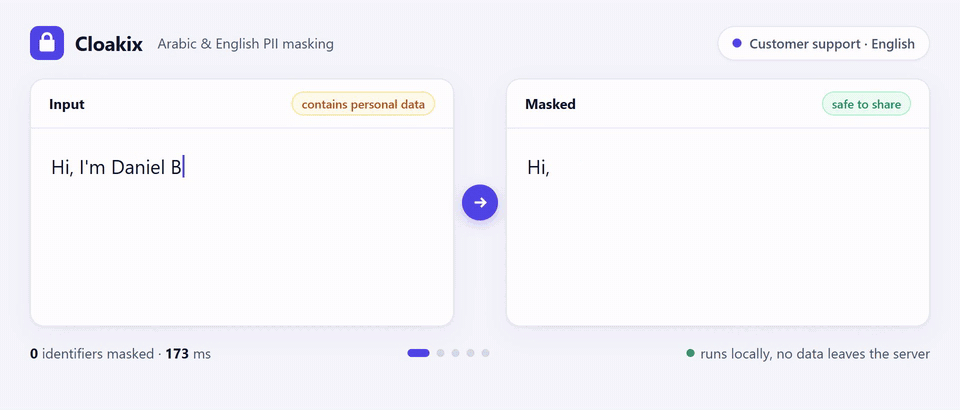

<div align="center">

# Cloakix

**Detect and mask personal data in Arabic and English text, before it reaches an LLM, a database, a log or a third party.**

[](LICENSE)
[](pyproject.toml)
[](docs/api.md)
[](docs/entities.md)



[Quick start](#quick-start) · [What it detects](#what-it-detects) · [Under the hood](#under-the-hood) · [REST API](docs/api.md) · [Docs](docs/usage.md)

</div>

---

Cloakix finds personal identifiers (names, phone numbers, national IDs, payment cards, IBANs,
medical record numbers and more) and replaces them with safe tags such as `<PERSON_1>`.
It is built for **Arabic, English and mixed text**, with validated formats for the **Gulf (GCC)
and Egypt**. It runs **entirely on your own servers**.

## Why Cloakix

- **Arabic-first.** Handles Arabic-Indic digits (`٠٥٥…`), hidden Unicode characters, diacritics,
  attached prefixes (`للدكتور`, `ورقم`) and Arabic/English mixed in one sentence.
- **Validated regional formats.** National IDs, phones and IBANs are checked with check digits
  or structure rules, not just matched with a pattern.
- **Context-aware.** Numbers with no fixed format, such as file, order or account numbers, are
  found from nearby words like `MRN`, `رقم الملف`, `order` or `حساب`.
- **Private by design.** No external calls and no telemetry. Results never contain the original
  values.
- **Use it from any stack.** A Python library, a REST API, a CLI and a Docker image.

## Use cases

| | |
|---|---|
| **AI and LLM applications** | Mask prompts and documents before sending them to any LLM API |
| **Customer support and CRM** | Tickets, chats, emails and call transcripts |
| **Banking and fintech** | Card numbers, IBANs, account numbers, customer IDs |
| **Healthcare** | Patient feedback, notes, MRNs and insurance numbers |
| **Government and HR** | National IDs, Iqama, Emirates ID, passports, employee records |
| **Analytics and logs** | Store, analyse and share text without exposing identities |

## Quick start

```bash
git clone https://github.com/good2idnan/cloakix.git && cd cloakix
pip install -e ".[ner,api]"
```

**Python**

```python
from cloakix import Masker

masker = Masker()
masker.mask("New employee Sara Al-Qahtani (Iqama 2012345670) joined on 5 March 2026, mobile 0559998877").text
# 'New employee <PERSON_1> (Iqama <NATIONAL_ID_1>) joined on <DATE_1>, mobile <PHONE_1>'
```

**REST API (Docker)**

```bash
docker build -t cloakix . && docker run -d -p 8000:8000 cloakix
curl -X POST localhost:8000/v1/mask -H "Content-Type: application/json" \
     -d '{"text": "Call me on +971 50 123 4567"}'
# {"masked_text": "Call me on <PHONE_1>", "entities": [...]}
```

## Examples

<table>
<tr><th>Domain</th><th>Input</th><th>Output</th></tr>
<tr>
<td>Support</td>
<td>Hi, I'm Daniel Brooks. My order #A-559821 never arrived, email daniel.b@gmail.com</td>
<td>Hi, I'm <code>&lt;PERSON_1&gt;</code>. My order #<code>&lt;REFERENCE_NUMBER_1&gt;</code> never arrived, email <code>&lt;EMAIL_1&gt;</code></td>
</tr>
<tr>
<td>Banking</td>
<td dir="rtl">أرجو تحويل المبلغ إلى الآيبان SA03 8000 0000 6080 1016 7519 باسم فيصل العنزي</td>
<td dir="rtl">أرجو تحويل المبلغ إلى الآيبان <code dir="ltr">&lt;IBAN_1&gt;</code> باسم <code dir="ltr">&lt;PERSON_1&gt;</code></td>
</tr>
<tr>
<td>Government</td>
<td dir="rtl">الرقم القومي 29001010112345 وموبايلي 01012345678</td>
<td dir="rtl">الرقم القومي <code dir="ltr">&lt;NATIONAL_ID_1&gt;</code> وموبايلي <code dir="ltr">&lt;PHONE_1&gt;</code></td>
</tr>
<tr>
<td>Healthcare</td>
<td dir="rtl">الدكتور خالد الحربي كان ممتاز، جوالي ٠٥٥١٢٣٤٥٦٧ ورقم الملف 778812</td>
<td dir="rtl">الدكتور <code dir="ltr">&lt;PERSON_1&gt;</code> كان ممتاز، جوالي <code dir="ltr">&lt;PHONE_1&gt;</code> ورقم الملف <code dir="ltr">&lt;MRN_1&gt;</code></td>
</tr>
</table>

Replace with tags (`<PERSON_1>`), types (`<PERSON>`), `[REDACTED]`, partial masks (`******4567`)
or stable keyed hashes. See the [usage guide](docs/usage.md).

## What it detects

| Category | Identifiers |
|---|---|
| **People** | Names in Arabic and English, with or without titles |
| **Contact** | Phone numbers (GCC, Egypt, international), email, URL, social handles, IP addresses |
| **Government IDs** | Saudi ID and Iqama · Emirates ID · Qatar QID · Kuwait Civil ID · Bahrain CPR · Oman Civil No. · Egyptian National ID · passports |
| **Financial** | Payment cards (Luhn) · IBAN (mod-97) · bank accounts · reference/order numbers |
| **Healthcare** | Medical record numbers · insurance numbers |
| **Other** | Dates (Gregorian and Hijri) · addresses and P.O. boxes · cities · any other long number |

Full list with validation rules: [docs/entities.md](docs/entities.md).

## Under the hood

```
text ─► normalize ─► detect ─────────────────────────────► merge ─► replace
         (digits,     rules + check digits · context words      (overlaps,   (<PERSON_1>,
          Unicode)    name rules · NER models · known values     priority)    ******4567 …)
```

| Layer | Technology | |
|---|---|---|
| Detection engine | Cloakix's own engine, pure Python standard library (`re`, `unicodedata`, `hmac`, `ipaddress`) | core, no dependencies |
| Arabic names and places | [CAMeLBERT-Mix NER](https://huggingface.co/CAMeL-Lab/bert-base-arabic-camelbert-mix-ner) by CAMeL Lab, NYU Abu Dhabi (Apache-2.0) | optional `[ner]` |
| English names and places | [BERT-base NER](https://huggingface.co/dslim/bert-base-NER) (MIT) | optional `[ner]` |
| Model runtime | Hugging Face Transformers + PyTorch, CPU is enough | optional `[ner]` |
| REST API | FastAPI · Uvicorn · Pydantic | optional `[api]` |
| Packaging | Docker image with the models included, runs offline | |

## Performance

Measured with the Docker image on a laptop CPU (no GPU), on 750 synthetic Arabic, English and
mixed comments:

| | |
|---|---|
| Identifiers masked | **99.3%** (phones, IDs, cards, IBANs, emails, MRNs, cities, dates: 100%) |
| Clean comments wrongly changed | **0 of 150** |
| Latency per request | ~45 ms typical, under 100 ms for 95% of requests |
| Memory | ~700 MB per container |

Results on synthetic data are a starting point. Always evaluate on a sample of your own data.

## Documentation

| | |
|---|---|
| [Usage](docs/usage.md) | Options, operators, known values, CLI, offline models |
| [REST API](docs/api.md) | Endpoints, Docker, configuration |
| [Supported identifiers](docs/entities.md) | Every type and its validation rule |
| [How it works](docs/how-it-works.md) | Normalization, scoring, merging |
| [Extending](docs/extending.md) | Add a country, language or industry in one file |

## Limitations

Cloakix reduces risk but cannot guarantee that every identifier is found. Keep a human review
step for public releases. Masked text that can be linked back to a person is *pseudonymized*,
not anonymized, under GDPR, Saudi PDPL and similar laws.

## Contributing

Contributions are welcome, especially new countries, languages and identifier formats. See
[CONTRIBUTING.md](CONTRIBUTING.md). Never include real personal data. Report security issues
privately via [SECURITY.md](SECURITY.md).

## License

[Apache-2.0](LICENSE). The NER models are downloaded separately and keep their own licenses
([NOTICE](NOTICE)).
