<div align="center">



# Cloakix

**Mask personal identifiers in Arabic and English text, before it reaches an LLM, a database or anyone else.**

[](LICENSE)
[](pyproject.toml)

[Quick start](#quick-start) · [What it finds](docs/entities.md) · [How it works](docs/how-it-works.md) · [REST API](docs/api.md) · [Docs](docs/usage.md)

</div>

## Why Cloakix

- **Arabic-first.** Handles Arabic-Indic digits (`٠٥٥…`), hidden Unicode characters, diacritics,
  attached prefixes (`للدكتور`, `ورقم ملفي`) and mixed Arabic/English text.
- **Gulf and Egypt identifiers.** Saudi ID and Iqama, Emirates ID, QID, Civil ID, CPR and Egyptian
  National ID, plus local phone formats, validated with check digits where they exist.
- **Healthcare-aware.** Finds MRNs and insurance numbers in any format from context words such as
  `MRN` or `رقم الملف`.
- **More than regex.** Combines rules, checksums, context words, name rules and optional
  Arabic and English NER models.
- **Private by design.** Runs on your own servers and makes no external calls. Results never
  contain the original values.

## Quick start

```bash
git clone https://github.com/good2idnan/cloakix.git && cd cloakix
pip install -e ".[ner,api]"
```

```python
from cloakix import Masker

masker = Masker()
masker.mask("اسمي أحمد العتيبي، جوالي ٠٥٥١٢٣٤٥٦٧، رقم الملف 778812").text
# 'اسمي <PERSON_1>، جوالي <PHONE_1>، رقم الملف <MRN_1>'
```

Or run the REST API:

```bash
docker build -t cloakix . && docker run -p 8000:8000 cloakix
curl -X POST localhost:8000/v1/mask -H "Content-Type: application/json" -d '{"text": "Call me on +971 50 123 4567"}'
# {"masked_text": "Call me on <PHONE_1>", "entities": [...]}
```

## Examples

<table>
<tr><th>Input</th><th>Output</th></tr>
<tr>
<td dir="rtl">زرت المستشفى مع أخي فهد السبيعي في الرياض</td>
<td dir="rtl">زرت المستشفى مع أخي <code dir="ltr">&lt;PERSON_1&gt;</code> في <code dir="ltr">&lt;LOCATION_1&gt;</code></td>
</tr>
<tr>
<td dir="rtl">موبايلي 01012345678 والرقم القومي 29001010112345</td>
<td dir="rtl">موبايلي <code dir="ltr">&lt;PHONE_1&gt;</code> والرقم القومي <code dir="ltr">&lt;NATIONAL_ID_1&gt;</code></td>
</tr>
<tr>
<td>Great care from Dr. Sara Al-Qahtani, MRN A-55821</td>
<td>Great care from Dr. <code>&lt;PERSON_1&gt;</code>, MRN <code>&lt;MRN_1&gt;</code></td>
</tr>
</table>

Replace with tags, types, `[REDACTED]`, partial masks (`******4567`) or stable keyed hashes.
You can also pass values you already know, such as the patient's name from your database.
See the [usage guide](docs/usage.md).

## Documentation

| | |
|---|---|
| [Usage](docs/usage.md) | Options, operators, known values, CLI, offline models |
| [Supported identifiers](docs/entities.md) | Every type and its validation rule |
| [How it works](docs/how-it-works.md) | Normalization, scoring, merging |
| [REST API](docs/api.md) | Endpoints, Docker, configuration |
| [Extending](docs/extending.md) | Add a country, language or industry in one file |

## Limitations

Cloakix reduces risk but cannot guarantee that every identifier is found. Test it on a sample
of your own data, and keep a human review step for public releases. The Arabic NER model was
trained on formal news text, so names written in dialect may be missed more often.

## Contributing

Contributions are welcome, especially new countries, languages and identifier formats. See
[CONTRIBUTING.md](CONTRIBUTING.md). Never include real personal data. Report security issues
privately: see [SECURITY.md](SECURITY.md).

## License

[Apache-2.0](LICENSE). The NER models are downloaded separately and keep their own licenses
([NOTICE](NOTICE)). The design is inspired by
[Microsoft Presidio](https://github.com/data-privacy-stack/presidio).
